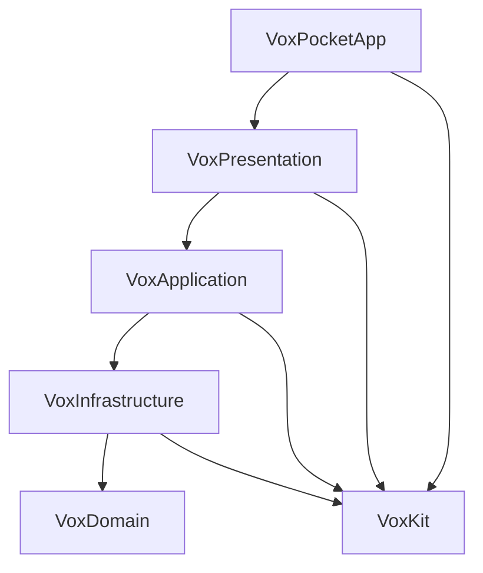

# Phase 2 architecture

Last-Reviewed: 2026-11-06

Products: Domain = CoreModels/TextHistory; Infrastructure = VoxKitBridge/Persistence/
PlatformAdapters/Preferences; Application = UseCases; Presentation = UIShared/PlatformUI/WidgetUI.
Domain has no dependencies; LokiKit is external; VoxUITesting is standalone.

| Product | Responsibility | Dependencies |
|---|---|---|
| VoxCore | Values, async sessions, injected services | None |
| VoxRefine | Refinement/analysis models and prompts | VoxCore |
| VoxSpeech | Apple/Azure speech | VoxCore, AsyncAlgorithms |
| VoxLLM | Apple Intelligence/Azure Foundry providers | VoxCore, VoxRefine, AsyncAlgorithms |
| VoxSpeechWhisperKit | Local/hybrid speech | VoxCore, VoxSpeech, WhisperKit |

Sources: `Packages/VoxKit/Sources/<Product>/`; no CoreModels/LokiKit/Combine/host
dependencies. Workflow products follow in Phase 3.

Bridge: Combine sessions, credentials, Loki adapters; depends on
VoxCore/VoxSpeech/CoreModels/LokiKit. UseCases consume Bridge speech and
VoxRefine/VoxLLM refinement; Persistence stores sessions/history. Inject
CredentialProvider/redacted Credential and VoxStorageLocations. Never log SDK output.

Golden (a)/(c) stay byte-identical; routing (b) and Combine/Loki tests are host-owned.
Voice suites cover both speech targets and Bridge. MinimalConsumer gates four
non-WhisperKit products on macOS/iOS Simulator: no missing modules or WhisperKit linkage.
